# OpenDot 运行时笔记

这份仓库收录 OpenDot 源码和我的运行时分析。两张图聚焦一次本地 Durable 文本会话，沿代码追踪请求受理、模型执行、进度更新和最终回复。

## 高层运行时架构图

浏览器通过 Hono HTTP 接口提交消息，并接收 WebSocket 事件。Node 宿主中的 `ProductRuntimeService` 管理会话授权和结果投影，Pi Durable 适配器接入 SDK Harness 和 SQLite 检查点。图中标出了浏览器到宿主以及宿主到外部模型 API 的边界。

## 端到端执行时序图

HTTP 回执确认请求已受理。后台执行期间，客户端通过 `durable_session_update` 接收进度，最终回复写入存储后经 `new_message` 推送。

## 源码入口

| 环节 | 文件 |
| --- | --- |
| HTTP 消息受理与 WebSocket 推送 | [src/web.ts](src/web.ts#L319) |
| Durable 提交、进度投影与结果落库 | [product-runtime.ts](src/personal-agent/product-runtime.ts#L2122) |
| 本地 Harness 与 SQLite 检查点 | [durable-runtime.ts](src/personal-agent/durable-runtime.ts#L180) |
| 模型配置与调用适配 | [product-model.ts](src/personal-agent/product-model.ts#L217) |

## 源码来源与许可

项目源码来自 OpenDot。本仓库的展示内容是运行时架构图、执行时序图和调用链整理。原始项目说明与版权声明保存在下方链接。

[上游 OpenDot](https://github.com/helsome/OpenDot) · [原始项目说明](README.upstream.md) · [MIT 许可证](LICENSE)
